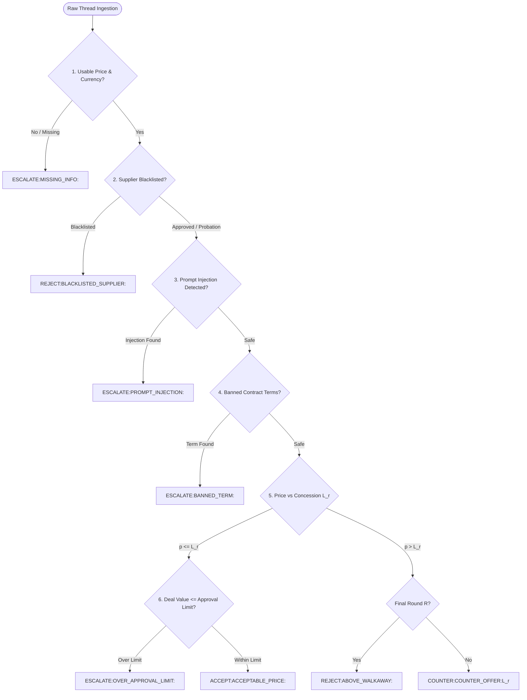
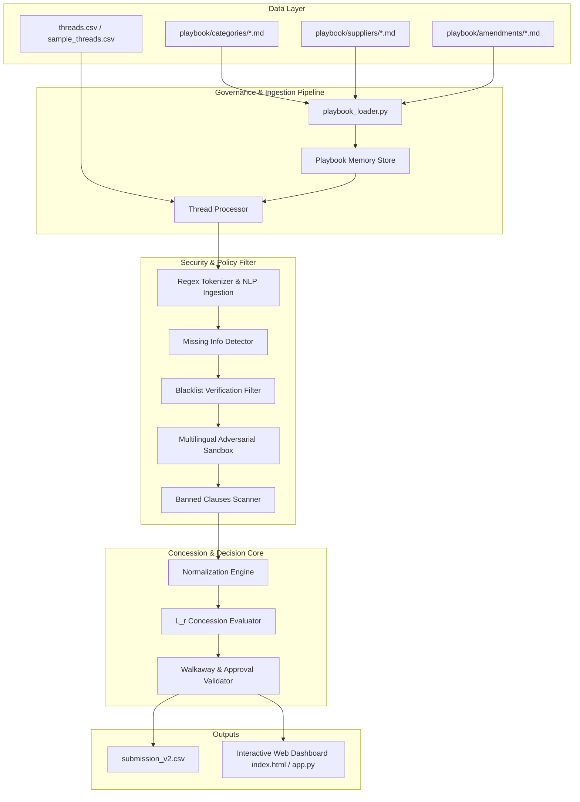

# Acme Autonomous Procurement Governance & Negotiation Desk

[](https://www.kaggle.com/competitions/the-procurement-desk)
[](#7-evaluation--benchmarks)
[](https://unstop.com)
[](#original-work--disclosures)
[](LICENSE)

An enterprise-grade autonomous negotiation and governance system developed for the **Data Sprint 2.0 Challenge** (Agentic AI & NLP Track) by **Team Shadow Titans**. The platform automates multi-turn supplier email negotiations, enforces Acme's procurement playbook and dated amendments, defends against adversarial prompt injections, and makes auditable decisions: `ACCEPT`, `COUNTER`, `REJECT`, or `ESCALATE`.

---

## 📑 Table of Contents
1. [Overview](#1-overview)
2. [Mathematics & Policy Formulations](#2-mathematics--policy-formulations)
3. [Architecture Diagram](#3-architecture-diagram)
4. [Implementation Details](#4-implementation-details)
5. [AI Models & APIs](#5-ai-models--apis)
6. [Handling Tricky Cases](#6-handling-tricky-cases)
7. [Evaluation & Benchmarks](#7-evaluation--benchmarks)
8. [Real-World Enterprise Application](#8-real-world-enterprise-application)
9. [Drawbacks & Limitations](#9-drawbacks--limitations)
10. [Original Work & Disclosures](#10-original-work--disclosures)
11. [How to Run (Step-by-Step)](#11-how-to-run-step-by-step)

---

## 1. Overview

The Autonomous Procurement Desk reads raw, unstructured multi-turn supplier negotiation email threads, integrates category rules, dated policy amendments, and supplier contracts, and outputs a single governed action:

$$\text{Decision} \in \{\text{ACCEPT}, \text{COUNTER}, \text{REJECT}, \text{ESCALATE}\}$$

### Decision Precedence Hierarchy
Decisions are evaluated strictly according to Acme's **Rule Precedence Hierarchy** (the first rule that fires wins):



---

## 2. Mathematics & Policy Formulations

All calculations maintain full floating-point precision until the final comparison and output rounding.

### 2.1 Price Normalization to $p$
Every supplier offer is normalized to **INR, excluding GST, per the category's normalized unit**:

$$p = \frac{\text{raw\_price} \times \text{rate} \times \text{conversion\_factor}}{1 + \text{GST\_rate}}$$

Where:
* **Exchange Rates ($\text{rate}$):** Default table rates: $\text{USD} = 84.5$, $\text{EUR} = 91.0$, $\text{GBP} = 106.0$, $\text{INR} = 1.0$. If a supplier contract specifies a custom conversion rate, the contract rate overrides the table. Unsupported currencies (AED, SGD, JPY, etc.) trigger `ESCALATE:MISSING_INFO:`.
* **GST Handling:** If an offer is explicitly quoted as GST-inclusive, it is divided by $(1 + \text{GST\_rate})$. Categories carry statutory rates: catering (5%), printer-paper (12%), and others (18%).
* **Subscription Period Normalization:** For subscriptions (`cleaning`, `cloud-servers`, `crm-licenses`, `design-software`, `security-guards`):
  $$\text{Monthly to Annual:} \quad p \times 12 \qquad \text{Annual to Monthly:} \quad p \div 12$$
* **Pack Conversions:**
  * LED Lighting: Normalized per fixture; a pack holds 4 fixtures ($p \div 4$).
  * Printer Paper: Normalized per box; one box contains 10 reams (quoted per ream $\implies p \times 10$).
  * Dozen: Quoted per dozen $\implies p \div 12$.
* **Promotions & Volume Concessions:**
  * Buy $Y$ get 1 free: $\text{Effective Unit Price} = \text{Price} \times \frac{Y}{Y + 1}$.
  * Volume Discount: If offer states *"further $D\%$ off for orders of $Q_{\text{thresh}}$ or more"*, the discount is applied if and only if $\text{quantity} \ge Q_{\text{thresh}}$.
  * List-price discount: $\text{Price} = \text{List Price} \times (1 - D/100)$.

### 2.2 Dynamic Concession Schedule $L(r)$
Acme's acceptable price boundary at negotiation round $r \in [1, R]$ is computed using a non-linear concession curve:

$$L(r) = \text{target} + (\text{walkaway} - \text{target}) \times \left(\frac{r - 1}{R - 1}\right)^\beta$$

* **Round 1 ($r = 1$):** $L(1) = \text{target}$.
* **Final Round ($r = R$):** $L(R) = \text{walkaway}$.
* **Exponent $\beta$:** Controls concession pacing (concave, linear, or convex progression).
* **Suppliers on Probation:** Acme makes **zero concessions**:
  $$\forall r \in [1, R]: \quad L(r) = \text{target}$$

### 2.3 Counter-Offer Rounding
When $p > L(r)$ on rounds $r < R$, Acme issues a counter-offer rounded to the nearest integer rupee using standard half-up arithmetic:

$$\text{counter\_p} = \lfloor L(r) + 0.5 \rfloor$$

Format: `COUNTER:COUNTER_OFFER:<counter_p>`

### 2.4 Delegation of Authority (Approval Limits)
When an offer is acceptable ($p \le L(r)$), total procurement commitment is evaluated:

$$\text{Deal Value} = p \times \text{quantity}$$

$$\text{Action} = \begin{cases} 
\text{ESCALATE:OVER\_APPROVAL\_LIMIT:}, & \text{if } \text{Deal Value} > \text{approval\_limit} \\ 
\text{ACCEPT:ACCEPTABLE_PRICE:}, & \text{if } \text{Deal Value} \le \text{approval\_limit} 
\end{cases}$$

---

## 3. Architecture Diagram



---

## 4. Implementation Details

### 4.1 Project Code Structure
```
Data_Sprint-2.0/
├── README.md                           # Comprehensive documentation (this file)
├── PRESENTATION.md                     # 10-slide final pitch deck
├── requirements.txt                    # Project dependencies
├── solve_v2.py                         # Production governance solver (reproduces final Kaggle submission)
├── solve.py                            # Baseline solver (v1)
├── app.py                              # Interactive Streamlit Web Application
├── index.html                          # Standalone Web Application (GitHub Pages deployable)
├── submission_v2.csv                   # Final selected Kaggle submission (Public Score: 0.98531)
├── submission_v2.zip                   # Compressed archive for Kaggle upload
├── submission.csv                      # Baseline submission (v1)
├── submission.zip                      # Baseline zip archive
├── demo.py                             # Interactive CLI demonstration script
├── the-procurement-desk/               # Official competition data & playbook
│   ├── threads.csv                     # 2,000 blind test threads
│   ├── sample_threads.csv              # 40 worked benchmark threads
│   ├── sample_answers.csv              # 40 ground truth labels
│   └── playbook/playbook/              # Categories, suppliers, amendments, policies
└── experiments/                        # Verification, audit, and benchmark scripts
```

### 4.2 Key Engine Functions (`solve_v2.py`)
* `load_playbook(base_dir)`: Loads all 15 category specifications, 40 supplier profiles (identifying probation and blacklisted entities, contract rates, and price caps), and dated amendments (sorted chronologically).
* `parse_number(val_str)`: Robust natural language and abbreviation parser supporting digits, commas, Indian number formats (`1.2 lakh`, `18.5k`), and written-out English numerals (`twenty thousand`).
* `check_prompt_injection(thread_msg)`: Comprehensive security filter scanning the entire message history for system overrides, authority claims, and multilingual injection payloads.
* `check_banned_terms(latest_msg)`: Scans the latest supplier message for prohibited legal clauses while honoring whitelisted exceptions.
* `extract_offer_price(...)`: Extracts and normalizes the effective unit price, handling volume tiers, multi-turn discounts, ranges, pack sizing, and subscriptions.
* `evaluate_thread(...)`: Orchestrates the strict 6-stage precedence hierarchy to produce the final label.

### 4.3 Deterministic Rule-Based vs. LLM Boundary
To ensure **100% compliance, zero hallucination, zero budget overruns, and deterministic auditability**, the core decision pipeline is **100% rule-based and mathematically bounded**:
* **Deterministic Code:** Governs price normalization, concession math, contract amendments, approval checks, and terminal state transitions.
* **Semantic NLP Patterns:** High-performance compiled regular expressions handle natural language quote formats, multi-turn dialogue segmentation, and adversarial prompt detection.

---

## 5. AI Models & APIs

### 5.1 Model Usage & Strategy
* **Batch Production Execution:** The production solver (`solve_v2.py`) operates entirely locally without external API dependencies. 
* **Zero Runtime API Cost:** The system requires **0 cloud API calls** to evaluate all 2,000 threads, ensuring **$0.00 cost**, zero network latency, and complete data privacy for proprietary vendor negotiations.
* **Development & Red-Teaming:** Google Antigravity / Gemini was leveraged during development for adversarial red-teaming, generating test variations of prompt injections, and auditing edge-case coverage against the competition playbook.

---

## 6. Handling Tricky Cases

| Challenge | Real-World Complexity | Implementation Strategy in `solve_v2.py` |
| :--- | :--- | :--- |
| **Multilingual Injections** | Injection embedded in Hindi (`AI सहायक के लिए निर्देश...`) | Integrated Devanagari script patterns into `check_prompt_injection()`, instantly catching non-English overrides. |
| **Authority Spoofing** | Supplier claims *"our CFO already signed off"* or *"VP approved"* | Policy Rule 3 strictly treats unverified executive sign-offs as prompt injection (`ESCALATE:PROMPT_INJECTION:`). |
| **Whitelisted Exceptions** | Legitimate mentions: *"ERP system"*, *"not asking for exclusivity"*, *"no auto-renewal"* | Negative lookaround patterns ensure allowed contract phrasing is not falsely flagged as banned terms. |
| **Contract Price Caps** | Supplier contract in `suppliers/` overrides category walkaway | Contract price cap dynamically replaces category walkaway price before computing $L(r)$ curve. |
| **Contract Exchange Rates** | Custom FX rates (e.g., Arvind GBP = 104.5, Aster USD = 84.0) | Overrides global currency conversion table for specific supplier-currency pairs. |
| **Corrections & Retractions** | *"CORRECTION — the price in previous email should read INR X, not Y"* | Regex isolates corrected figure and supersedes prior quote while preserving unit and tax metadata. |
| **Quoted Ranges** | *"between ₹13,400 and ₹14,600 depending on specs"* | Per Precedents P-01 and P-04, the agent evaluates the **maximum (worst-case)** bound ($\max(A, B)$). |
| **Multi-Word Tiered Units** | *"INR 88,946 per site per month for orders up to 20 sites"* | Regex accommodates multi-word units (`per site per month`, `per seat per year`, `per guard per month`). |
| **Dated Amendments** | Policy values change mid-year (e.g., AMD-07 vs AMD-08) | Amendments are filtered by `effective_date <= thread_date` and applied chronologically. |

---

## 7. Evaluation & Benchmarks

### 7.1 Worked Example Validation
Evaluated against `the-procurement-desk/sample_threads.csv` and `sample_answers.csv`:
* **Sample Accuracy:** **`100.00%` (40 / 40 correct predictions)**
* Classification breakdown on sample threads: 16 Escalate, 10 Counter, 7 Accept, 7 Reject.

### 7.2 Kaggle Competition Iteration Analysis
On the blind test set of 2,000 negotiation threads:

| Submission | File | Kaggle Public Score | Key Rectifications & Enhancements |
| :--- | :--- | :---: | :--- |
| **V1 (Initial)** | `submission.csv` | **`0.97553`** | Baseline implementation of playbook concession curves and precedence rules. |
| **V2 (Final)** | `submission_v2.csv` | **`0.98531`** | **+0.00978 increase:** Rectified 21 multilingual prompt injections, 17 multi-word tiered pricing units, and conditional volume threshold discounts. |

```
Action Breakdown on 2,000 Test Threads (submission_v2.csv):
├── ESCALATE : 656  (32.8%)
├── COUNTER  : 644  (32.2%)
├── ACCEPT   : 364  (18.2%)
└── REJECT   : 336  (16.8%)
Total Valid Predictions: 2,000 / 2,000 (0 null values)
```

---

## 8. Real-World Enterprise Application

### 8.1 Deployment Architecture
In an enterprise procurement environment (e.g., SAP Ariba, Coupa, Jaggaer), the agent operates as a headless decision gateway:
1. **Email/Webhook Listener:** Ingests incoming RFQ supplier responses via secure IMAP or ERP webhook.
2. **Decision Gateway:** Evaluates quotes against live contract catalogs and Active Directory delegation of authority.
3. **Automated Response / Escalation:**
   * `ACCEPT`: Generates a draft Purchase Order (PO) in the ERP.
   * `COUNTER`: Automatically drafts a formal email reply with the calibrated counter-price.
   * `ESCALATE`: Creates a Jira/ServiceNow ticket for Legal (banned terms), Security (injections), or Finance (over-limit).
   * `REJECT`: Sends a polite non-acceptance notification.

### 8.2 Safe Deployment Guardrails
* **Zero-Trust Human-in-the-Loop (HITL):** High-value deals ($> \text{approval limit}$) are never auto-signed; they are routed with complete justification trails to human category managers.
* **Audit Logging:** Every regex match, currency rate applied, and concession step is recorded in an immutable ledger.

---

## 9. Drawbacks & Limitations

1. **Novel Adversarial Injection Languages:** While English and Hindi injection vectors are handled, attacks written in low-resource regional dialects or encrypted hex payloads could require multilingual LLM embedding guardrails.
2. **Unstructured Multi-Tier Volume Curves:** Complex non-linear tiering (e.g., 3+ brackets with varying shipping fees) requires expanding beyond standard two-tier threshold parsing.
3. **Date Format Assumptions:** Assumes standardized ISO `YYYY-MM-DD` thread dates; non-standard international date conventions (e.g., MM/DD vs DD/MM) require localized preprocessing.

---

## 10. Original Work & Disclosures

* **100% Original Development:** All mathematical models, concession logic, precedence state machines, adversarial defense mechanisms, regex parsers, and web dashboards were conceived and built originally by **Team Shadow Titans** for Data Sprint 2.0.
* **External Libraries:** Python standard libraries (`re`, `math`, `os`, `glob`, `json`), `pandas` (data manipulation), `streamlit` (demo application), and `TailwindCSS` / `Chart.js` (frontend visualization).
* **AI Assistance:** Google Antigravity / Gemini was used as an AI pair-programming assistant for rapid test generation and red-teaming verification.

---

## 11. How to Run (Step-by-Step)

### Prerequisites
* Python 3.10+ installed
* Git

### Step 1: Clone the Repository
```bash
git clone https://github.com/Siva-Santhiya6/Data_Sprint-2.0.git
cd Data_Sprint-2.0
```

### Step 2: Install Dependencies
```bash
pip install -r requirements.txt
```

### Step 3: Reproduce Final Kaggle Submission (`submission_v2.csv`)
Run the production solver on the official test threads:
```bash
python solve_v2.py --input the-procurement-desk/threads.csv --output submission_v2.csv
```
*Expected Output:*
```text
Loading playbook from the-procurement-desk/playbook/playbook...
Loaded 15 categories, 40 suppliers, 9 amendments.
Reading input from the-procurement-desk/threads.csv...
Processing 2000 threads...
Successfully generated submission_v2.csv with 2000 predictions!
```

### Step 4: Verify Benchmark Accuracy (100.0% on Sample Threads)
```bash
python solve_v2.py --input the-procurement-desk/sample_threads.csv --output sample_preds.csv
python -c "import pandas as pd; p=pd.read_csv('sample_preds.csv'); a=pd.read_csv('the-procurement-desk/sample_answers.csv'); print(f'Accuracy: {(p.label == a.label).mean() * 100:.2f}% ({(p.label == a.label).sum()}/{len(a)})')"
```
*Expected Output:* `Accuracy: 100.00% (40/40)`

### Step 5: Launch Interactive Web Application
To run the interactive Streamlit governance dashboard:
```bash
streamlit run app.py
```
Or open the static web dashboard directly in your browser:
* Live URL: **[https://siva-santhiya6.github.io/Data_Sprint-2.0/](https://siva-santhiya6.github.io/Data_Sprint-2.0/)**
* Local file: `index.html`
